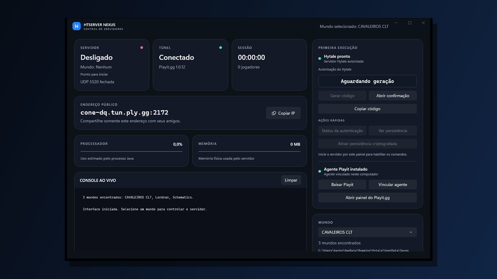

# HTServer Nexus

Aplicativo para Windows, desenvolvido em C# e WinUI 3, que centraliza a seleção de mundos, a execução do servidor dedicado do Hytale e o túnel do Playit.gg em uma única interface.

[](images/htserver-nexus-interface-1920x1080.png)

> [Baixar a versão mais recente](https://github.com/GabrielBarbosa0/HTSERVER-NEXUS/releases/latest) — instalador autocontido para Windows 64 bits.

> Projeto comunitário não oficial, sem vínculo com a Hypixel Studios.

## Interface gráfica

Baixe o arquivo `HTServer-Nexus-Setup-x.y.z.exe` na página de [Releases](https://github.com/GabrielBarbosa0/HTSERVER-NEXUS/releases), execute o instalador e abra **HTServer Nexus** pelo atalho da Área de Trabalho ou pelo menu Iniciar. O instalador inclui a aplicação e o runtime necessários; não é preciso instalar Visual Studio nem o SDK .NET.

O MVP atual oferece:

- status do servidor, túnel e porta UDP;
- início conjunto do Hytale e Playit.gg;
- controle independente para ligar ou desligar somente o túnel, inclusive com o servidor já ativo;
- descoberta automática e seleção dos mundos válidos na pasta de saves;
- título dinâmico com o nome do mundo selecionado;
- encerramento seguro do servidor pelo comando `/stop`;
- endereço público com cópia para a área de transferência;
- CPU, memória, uptime e jogadores detectados nos logs;
- console ao vivo com rolagem automática;
- configuração persistente de memória, porta e endereço;
- acesso rápido à pasta do mundo.
- diagnóstico da instalação, autorização Hytale e vinculação do Playit.gg;
- assistente para gerar e copiar o código de autorização Hytale, abrindo automaticamente a confirmação oficial;
- entrada de comandos no console visual;
- ações rápidas para consultar status e persistência da autenticação;
- indicação explícita do mundo em execução e do motivo de o seletor estar bloqueado;
- indicação se o processo está controlado pelo painel ou foi detectado externamente;
- encerramento de emergência de servidor externo, protegido por confirmação e aviso de salvamento;
- links oficiais para baixar e configurar o Playit.gg;
- execução normal do Playit.gg em segundo plano, sem uma segunda janela na barra de tarefas;
- ícone próprio do aplicativo no executável, na janela e no atalho.

## Primeiro uso em outro computador

1. Instale o Hytale pelo launcher oficial e tenha pelo menos um save com `config.json`.
2. Baixe a versão mais recente em [Releases](https://github.com/GabrielBarbosa0/HTSERVER-NEXUS/releases) e execute `HTServer-Nexus-Setup-x.y.z.exe`.
3. No painel, use **Baixar Playit** e depois **Vincular agente**. Entre na sua própria conta e crie um túnel UDP para `127.0.0.1:5520`.
4. Copie o endereço público desse túnel para **Configuração > Endereço público** e salve.
5. Selecione o mundo e inicie o servidor.
6. Se a autorização Hytale estiver pendente, pressione **Gerar código**, abra a confirmação e autorize com a sua própria conta Hytale.

O mundo só pode ser trocado com o servidor desligado. Se um servidor foi iniciado por outra janela, o painel consegue monitorá-lo, mas não consegue assumir sua entrada de console; encerre-o no console original antes de selecionar outro mundo.

Quando o console original não estiver disponível, **Encerrar processo externo** substitui o Gerenciador de Tarefas. Essa é uma opção de emergência: diferentemente de **Salvar e parar servidor**, ela não consegue enviar `/stop` e pode perder alterações posteriores ao último salvamento.

O console do Playit.gg fica oculto por padrão. Para vincular um agente, o iniciador o mostra temporariamente; para diagnóstico contínuo, ative **Mostrar console do Playit.gg no próximo início** nas configurações.

Contas, tokens, `auth.enc`, `auth.key`, `playit.toml`, mundos e endereços pessoais não são distribuídos pelo repositório.

## Uso rápido

1. Use o atalho **HTServer Nexus** na Área de Trabalho ou no menu Iniciar.
2. Selecione o mundo e pressione **Iniciar tudo**.
3. Aguarde a mensagem de que o universo está pronto.
4. Entre localmente pelo Hytale.
5. Envie aos amigos o endereço `cone-dq.tun.ply.gg:2172`.
6. Para desligar com segurança, use **Salvar e parar servidor**.

O firewall do Windows deve permanecer ativado. O iniciador reconhece quando o Playit.gg ou a porta UDP `5520` já estão em uso e evita iniciar uma segunda instância.

## Pré-requisitos

- Hytale instalado pelo launcher oficial.
- Um ou mais mundos com `config.json` em `%APPDATA%\Hytale\UserData\Saves`.
- Agente Playit.gg em `%LOCALAPPDATA%\PlayitGG\playit-windows-x86_64-signed.exe`.
- Cópia local de recuperação em `tools\playit-windows-x86_64-signed.exe` (ignorada pelo Git).
- Túnel Playit.gg configurado para encaminhar o endereço público à porta local UDP `5520`.
- Autenticação do servidor persistida no arquivo `auth.enc` do mundo.

## Documentação

Consulte [`docs/TDD.md`](docs/TDD.md) para o servidor e [`docs/GUI.md`](docs/GUI.md) para a arquitetura da interface.

## Desenvolvimento e geração do instalador

Os arquivos `.bat` foram mantidos somente em `scripts/bootstrap/` como ferramentas auxiliares para quem trabalha no código-fonte. Eles não fazem parte do fluxo do usuário comum.

Para compilar o instalador localmente, instale o SDK .NET 10 e o Inno Setup 6 e execute:

```powershell
powershell -ExecutionPolicy Bypass -File scripts\Build-Installer.ps1 -Version 1.1.0
```

O executável será criado em `artifacts\installer`. Tags no formato `v1.1.0` também acionam o workflow de release do GitHub, que compila e publica o instalador automaticamente.

Enquanto o projeto não possuir um certificado de assinatura de código, o Windows pode exibir o aviso de editor desconhecido. O arquivo deve ser obtido somente desta página oficial de Releases.

## Segurança

Este repositório não contém o mundo, backups, `auth.enc`, segredo do agente Playit.gg nem qualquer token. Esses dados devem continuar fora do Git.

O executável do Playit.gg também não entra nos commits. Nesta instalação existe uma cópia local ignorada em `tools\`; se o arquivo em `%LOCALAPPDATA%` desaparecer, o iniciador o restaura automaticamente.
